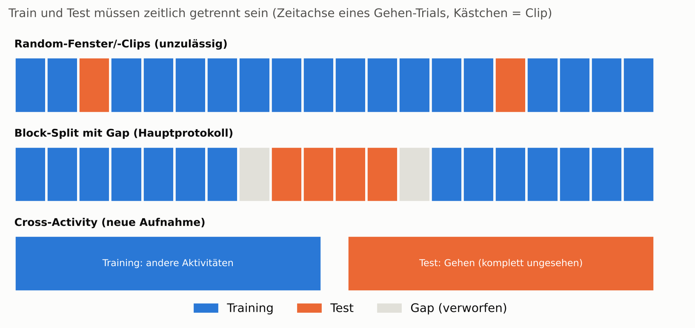

# Forschungsdesign: Personenerkennung aus AX6-Bewegungsdaten

> Stand 20.11.2026. Die lebende Fassung zum Kommentieren ist das Claude-Doc. Diese Kopie liegt im Repo, damit das ganze Team denselben Plan sieht.

Ein Modell ordnet einem Gehen-Clip die richtige von rund 25 Personen zu. Der eigentliche Beitrag ist der Nachweis, wie viel davon echte Personenerkennung ist und wie viel nur Wiedererkennung derselben Aufnahme, Sensorposition oder desselben Geräts. Dafür nutzen wir eine Validitätsleiter aus immer strengeren Splits und mehrere Shortcut-Kontrollen. Genau das bewertet die Forschungsstudie (45 %): klare Frage, nachvollziehbare Vergleiche, kritische Interpretation.

## Ausgangslage: was eure Daten erlauben

Pro Person und Aktivität gibt es genau eine Aufnahme an einem Tag. Damit sind Person und Aufnahme vollständig konfundiert. Wer Clips aus demselben Trial zuordnet, zeigt zunächst nur, dass dieselbe Aufnahme wiedererkannt wird. Die Projektpipeline (Abschnitt 7, Session-Risiko) verlangt, dass ihr genau das ausdrücklich benennt.

| Eigenschaft | Euer Datensatz | Konsequenz für die Studie |
| --- | --- | --- |
| Personen | ca. 25, pseudonymisierte IDs | Closed-Set-Identifikation, Zufallsniveau 4 % |
| Sessions | 1 Tag pro Person | Kein Test über Tage möglich, außer ihr nehmt ein Retest-Subset auf |
| Trials | 1 pro Aktivität, in Clips zerlegt | Clips sind keine unabhängigen Messungen. Train und Test nur als zeitlich getrennte Blöcke mit Gap |
| Sensoren | AX6 (Acc + Gyro): S01 rechte Hand, S02 linke Hand, S05 Rumpf, S06 Bein (in Dateinamen laut Konvention: `wrist-right`, `wrist-left`, `hip`, `ankle-…`) | Sensorposition als eigener Faktor (FF4) |
| Aktivitäten | Gehen, Treppe, Hampelmann, Ball, Squats, Türgriff, Händewaschen | Train auf anderen Aktivitäten, Test auf Gehen: euer strengster verfügbarer Test |
| Geräte | 7 AX6, Zuordnung zu Positionen unklar | Wechselt die Gerätekombination pro Person, kann ein Geräte-Fingerabdruck (Offsets, Gyro-Bias) die Person verraten |

Offene Fragen, die das Design beeinflussen:

- Wie lang sind Trials und Clips, und überlappen sich die Clips?
- Haben die Clips absolute Zeitstempel oder beginnt jeder Clip bei 0?
- Ist pro Aufnahme dokumentiert, welches AX6 (Seriennummer) an welcher Position saß?
- Mit welcher Samplingrate und welchen Messbereichen wurde aufgenommen?

## Forschungsfragen und Hypothesen

Kern sind FF1 bis FF3. Der Dozent erlaubt 1 bis 3 Forschungsfragen, deshalb ist FF4 eine Erweiterung, falls Zeit bleibt. Jede Hypothese ist so formuliert, dass ein Experiment sie widerlegen kann.

| | Forschungsfrage | Hypothese | Experiment | Poster-Abbildung |
| --- | --- | --- | --- | --- |
| FF1 | Wie gut lässt sich aus einem Gehen-Clip die Person bestimmen, und welche Methode eignet sich am besten? | Innerhalb einer Aufnahme liegen alle nicht-trivialen Modelle weit über 4 %. Bei so wenigen Daten ist das CNN den Feature-Modellen und MiniRocket nicht überlegen. | E1, E4 | Modellvergleich mit 95 %-KI, Evidenzkurve (Sekunden bis Erkennung) |
| FF2 | Wie stark hängt die gemessene Leistung vom Evaluationsprotokoll ab? | Random-Splits ≥ Block ohne Gap ≥ Block mit Gap > Cross-Activity (> Cross-Session) | E5, E7 | Validitätsleiter, Permutationstest |
| FF3 | Erkennt das Modell die Person oder den Sensorsitz bzw. das Gerät? | Eine Static-Probe (nur Achsen-Mittelwerte) erreicht innerhalb eines Tages hohe Werte. Rotationsinvariante Features übertragen sich besser auf neue Aufnahmen. | E6, E0 | Shortcut-Probe nach Feature-Set und Protokoll |
| FF4 (optional) | Welche Sensorposition und welche Aktivität tragen die meiste Identität? | Beim Gehen ist das Bein die informativste Einzelposition, alle vier zusammen sind am besten. Liu et al. (2025) fanden 94 % mit dem Unterschenkel-IMU, 84 % mit dem Handgelenk und 78 % mit der Hüfte. | E2, E3, E8 | Heatmap Sensor × Aktivität |

Vorschlag für den Postertitel: **„Erkennt das Modell die Person – oder nur die Aufnahme?“**

## Split-Design: die Validitätsleiter

Hauptprotokoll ist der Block-Split mit Gap. Jeder Trial wird in 5 zusammenhängende Zeitblöcke geteilt, getestet wird jeweils ein Block aus ganzen Clips. Zwischen Train und Test liegen mindestens 3 s (≥ 1 Fensterlänge). Alle Stufen laufen mit demselben Modell, damit nur das Protokoll variiert.

| Stufe | Protokoll | Training | Test | Was es zeigt |
| --- | --- | --- | --- | --- |
| ✗ | Random-Fenster | zufällige 3-s-Fenster | übrige Fenster, überlappen mit Training | nichts: Leakage, laut Projektpipeline unzulässig |
| ✗ | Random-Clips | zufällige Clips | Nachbar-Clips der Trainingsclips | stark überschätzt |
| ✗ | Block ohne Gap | 4 von 5 Blöcken | Nachbarblock ohne Abstand | Grenzfenster fast identisch |
| 1 | **Block mit Gap** | 4 von 5 Blöcken, ≥ 3 s Abstand | 1 Block, ganze Clips | Wiedererkennung der Aufnahme (Obergrenze) |
| 2 | **Cross-Activity** | alle anderen Aktivitäten desselben Tages | Gehen, komplett ungesehen | Die Signatur überträgt sich auf eine neue Aufnahme. Sensorsitz und Gerät können noch helfen. |
| 3 | **Cross-Session** | Tag 1 | Tag 2 (Retest-Subset) | echte Wiedererkennung der Person, nur mit Retest-Daten |

Die drei ✗-Zeilen sind Negativkontrollen. Sie zeigen auf dem Poster, wie viel ein falscher Split „schenkt“.

Umsetzungsdetails, die im Code automatisch geprüft werden:

1. Erst werden die Rohdaten aufgeteilt, dann entstehen Fenster, und zwar nur innerhalb der Train- bzw. Testteile (Projektpipeline, Abschnitt 8).
2. Überlappende Clips werden über ihre Zeitstempel erkannt und aus dem Training ausgeschlossen. Bei relativen Zeitstempeln fällt zusätzlich der Nachbarclip weg.
3. Für jede Fold zählt ein Leakage-Check überlappende Train/Test-Fensterpaare und misst den Mindestabstand. Das Ergebnis steht in jeder Ergebnistabelle.
4. Permutationstest auf Trial-Ebene: Die Personen-Labels werden zwischen Aufnahmen vertauscht. Beim Block-Split bleibt die Accuracy dann gleich, weil das nur eine Umbenennung ist. Das beweist, dass dieses Protokoll Person und Aufnahme nicht trennen kann. Bei Cross-Activity muss sie auf Zufallsniveau fallen.

## Pipeline, Modelle und Metriken

Alle Modelle bekommen dieselben Folds, Fenster und dieselbe Aggregation. Die Hyperparameter werden vorab festgelegt, damit keine Entscheidung auf Testdaten getroffen wird.

1. **Laden und QC:** Lücken über 0,1 s werden zu NaN und nicht still interpoliert. Einheiten werden auf g und °/s vereinheitlicht. Doppelte Zeitstempel, Clipping und Einheitenfehler (m/s² statt g) werden markiert.
2. **Synchronisation:** Die 4 Sensoren kommen auf ein gemeinsames 50-Hz-Raster, mit Anti-Aliasing-Filter auf der Schnittmenge ihrer Zeitbereiche.
3. **Split auf Rohdaten-Ebene** nach der Validitätsleiter.
4. **Fenster:** 3 s mit 1,5 s Schrittweite, nur innerhalb der Split-Teile. Fenster mit Lücke werden verworfen.
5. **Merkmale oder Rohfenster** gehen ins Modell. Skalierung wird nur auf Trainingsdaten gelernt.
6. **Aggregation pro Clip:** Die Log-Wahrscheinlichkeiten aller Fenster eines Clips werden gemittelt. Das Ergebnis beantwortet „Wem gehört dieser Clip?“.

| Modell | Eingabe | Rolle im Vergleich |
| --- | --- | --- |
| Mehrheit, Zufall | keine | Baselines laut Projektpipeline |
| Decision Tree, KNN, SVM (RBF), Random Forest | Merkmale | Vorgabe der Projektpipeline, interpretierbar |
| MiniRocket + Ridge-Klassifikator | Rohfenster | aktueller Stand für Zeitreihenklassifikation, schnell, kaum Hyperparameter |
| 1D-CNN (Keras 3) | Rohfenster | Deep-Learning-Vergleich mit Rotations-Augmentation gegen Sensorsitz-Effekte |

Vier Merkmalssätze, die zugleich die Shortcut-Analyse tragen:

- **Basis:** Mittelwert, Standardabweichung, Min, Max, RMS und Energie für alle Achsen und Beträge, wie in der Projektpipeline.
- **Erweitert:** zusätzlich Perzentile, Schiefe, Spektrum, Gang-Autokorrelation (Schritt- und Doppelschritt-Regularität nach Moe-Nilssen und Helbostad) sowie die Koordination zwischen den Sensoren.
- **Rotationsinvariant:** nur die Beträge |acc| und |gyr|. Sie bleiben gleich, egal wie der Sensor gedreht sitzt.
- **Static-Probe:** nur die Mittelwerte der Achsen. Sie dient als Diagnose, nicht als Modell fürs Ergebnis.

Metriken: Macro-F1 bleibt die zentrale Kennzahl (Projektpipeline), auf Fenster- und auf Clip-Ebene. Clip-Accuracy und Top-3 sind fürs Poster anschaulicher. Berichtet wird Mittelwert ± SD über die Folds und dazu ein 95 %-Konfidenzintervall per Cluster-Bootstrap über Personen, weil Clips derselben Person nicht unabhängig sind.

## Shortcut- und Confound-Kontrollen

Ein Modell kann eine Person auch über Nebenmerkmale erkennen: wie der Sensor sitzt, welches Gerät sie trug, oder ob nur die Aktivität verschieden ist. Diese Abkürzungen nennt man Shortcut Learning. Sie funktionieren nur innerhalb des Aufnahmetages und brechen bei neuen Bedingungen ein. Jede Kontrolle unten hat eine vorher festgelegte Lesart.

| Kontrolle | Deckt auf | So lest ihr das Ergebnis |
| --- | --- | --- |
| Static-Probe (nur Achsen-Mittelwerte) | Sensorsitz, Haltung, Kalibrier-Offsets, Gyro-Bias | Hoch bei Cross-Activity: Das Modell kann den Sensorsitz nutzen. Ergebnis mit invarianten Merkmalen gegenprüfen. |
| Rotationsinvariante Merkmale | ob die Erkennung ohne Ausrichtungsinformation trägt | Kleiner Verlust im Block-Split und Gewinn bei neuer Aufnahme: Die Bewegungsdynamik trägt die Identität. |
| Permutationstest auf Trial-Ebene | ob ein Protokoll Person oder Aufnahme misst | p ≈ 1 im Block-Split ist erwartet und selbst ein Befund. Bei Cross-Activity muss p klein sein. |
| Geräte-Check (E0) | ob Gerätekombinationen mit Personen zusammenfallen | Eine eigene Kombination pro Person ist ein Risiko. Besser: Jede Position nutzt immer dasselbe Gerät. |
| Analyse innerhalb einer Aktivität | Personen- statt Aktivitätsunterschiede | Die Hauptanalyse läuft nur auf Gehen, wie es die Projektpipeline verlangt. |
| t-SNE der Gehen-Fenster | ob Personen eigene Cluster bilden | Anschauung fürs Poster, kein Beweis. |

Der Code berechnet alle Kontrollen automatisch (E0, E6, E7). In den synthetischen Testdaten ist ein Sensorsitz-Effekt bewusst eingebaut. Dort erkennt die Static-Probe Personen über Aktivitäten hinweg fast perfekt, an einem neuen Tag aber kaum noch. Genau dieses Muster müsst ihr in euren echten Daten prüfen.

## Experimentplan E0–E8

E0 läuft immer zuerst. Danach kommen die Muss-Experimente, die FF1 bis FF3 beantworten. Ein Befehl startet alles (`python scripts/run_experiments.py --config configs/ax6_beta.yaml`), einzelne Experimente startet ihr mit `--only E0,E1`.

| Exp. | Frage | Aufbau | Ausgabe | Priorität |
| --- | --- | --- | --- | --- |
| E0 | Was steckt im Datensatz, wo sind Probleme? | Inventar, QC-Flags, Abdeckung Person × Aktivität, Geräte-Check, Leakage-Selbsttest | `coverage.png`, `qc_flagged.csv`, `device_check.csv` | Muss, zuerst |
| E1 | FF1: Welches Modell? | Gehen, Block-Split, 8 Modelle auf denselben Folds | Clip-Accuracy mit KI, Fenster-Macro-F1, Konfusionsmatrix | Muss |
| E5 | FF2: Wie ehrlich ist die Zahl? | Random Forest, 6 Protokolle inklusive Negativkontrollen | `E5_validity_ladder.png` | Muss |
| E6 | FF3: Person oder Sensorsitz? | 4 Merkmalssätze × Block, Cross-Activity und Cross-Session, dazu t-SNE | `E6_shortcut_probe.png` | Muss |
| E7 | FF2 und FF3 statistisch absichern | Permutationstest auf Trial-Ebene, Bootstrap-KIs | `E7_permutation.png` | Muss |
| E4 | FF1: Wie viele Sekunden braucht man? | Evidenzkurve je Protokoll, Fensterlänge 1 bis 6 s | `E4_evidence.png` | Soll |
| E2 | FF4: Welche Sensorposition? | Sensorkombinationen × Aktivitäten | Heatmap Sensor × Aktivität | Soll |
| E3 | FF4: Welche Aktivität? | je Aktivität, Leave-one-activity-out, Transfer A → B | `E3_per_activity.png`, Transfermatrix | Soll |
| E8 | FF4: Was trägt die Identität? | gruppierte Permutation Importance nach Sensor × Merkmalsfamilie | `E8_group_importance.png` | Kann |

Jeder Lauf speichert seine Konfiguration, die Softwareversionen und einen `REPORT.md` mit allen Kennzahlen. So ist jede Zahl auf dem Poster einem Lauf zuzuordnen.

## Empfehlungen für das Datensatz-Team

Die wichtigste Ergänzung ist ein kleines Retest-Subset. Erst damit wird Stufe 3 der Validitätsleiter möglich, und ihr könnt echte Personenerkennung zeigen. Diese Vorschläge zählen zugleich für die Mitarbeit am Datensatz (30 %), die Eigeninitiative und Verantwortung bewertet. Bringt sie für die erweiterte Datensatzversion ein und stimmt sie mit dem Dozenten ab.

- [ ] **Retest-Subset:** 5 bis 10 Personen gehen an einem zweiten Tag 1 bis 2 Minuten, mit neu angelegten Sensoren. Durch das Datum im Dateinamen wird das automatisch eine neue Session.
- [ ] **Re-Attachment-Test** als günstigere Alternative: Am Ende der Session Sensoren abnehmen, neu anlegen und noch einmal 1 Minute gehen.
- [ ] **Sensor-ID dokumentieren:** welches AX6 (Seriennummer) an welcher Position saß, pro Datei im zentralen Log.
- [ ] **Feste Zuordnung Gerät ↔ Position** für alle Personen. Dann trägt das Gerät keine Personeninformation.
- [ ] **Absolute Zeitstempel** in den Clips behalten und festhalten, ob sich Clips überlappen.
- [ ] **Sensorausrichtung standardisieren:** Ausrichtung festlegen, Position am Band notieren, ein Foto pro Person.
- [ ] **Sync-Ereignis** zu Beginn jeder Aufnahme, zum Beispiel drei Sprünge. Die AX6-Uhren haben eine typische Genauigkeit von ±50 ppm, über Stunden summiert sich das.
- [ ] **Bedingungen notieren:** gleiche Gehstrecke, Schuhwerk, Uhrzeit. Das sind mögliche Störgrößen.

## Zeitplan bis zur Abgabe

Woche 12 ist der wichtigste Termin. Ab dem finalen Datensatz ändert ihr nichts mehr an Splits, Merkmalen und Modellen. So ist kein Ergebnis auf die Testdaten hin optimiert, und ihr könnt das im Fachgespräch belegen.

| Wochen | Phase | Inhalt | Meilenstein |
| --- | --- | --- | --- |
| bis W7 | Fragen und Pipeline | FF1 bis FF3 festlegen, E0 auf den Beta-Daten, Leakage-Selbsttest und Geräte-Check prüfen | Forschungsfragen vorstellen |
| W8–W9 | Erste Ergebnisse | E1, E5 und E6 auf Beta-Daten, Retest-Subset im Datensatz-Team vorschlagen | Erweiterter Datensatz |
| W9–W11 | Alle Experimente | E0 bis E8 auf dem erweiterten Datensatz, Interpretation und Grenzen festhalten | Vorläufige Ergebnisse |
| **W12** | **Analyseplan einfrieren** | **Config, Splits und Modelle festschreiben, finaler Lauf auf Datensatz v1.0** | **Finaler Datensatz v1.0** |
| bis Abgabe | Poster, Doku, Fachgespräch | Abbildungen, README, CONTRIBUTIONS.md, Fachgespräch üben | Abgabe 1 Woche vor der Prüfung |

Die Wochen folgen den Meilensteinen aus den Einführungsfolien. Das genaue Abgabedatum hängt vom Prüfungstermin ab.

## Arbeitsteilung im 2er-Team

Legt die Arbeitsteilung schriftlich fest. Die Prüfungsordnung verlangt bei Gruppenprüfungen, dass Einzelleistungen eindeutig erkennbar, gekennzeichnet und separat bewertbar sind (§ 18d Abs. 3). Vorschlag und Vorlage: [`CONTRIBUTIONS.md`](../CONTRIBUTIONS.md). Jede Aufgabe ist im Kanban (GitHub-Issues) genau einer Person zugewiesen, Commits laufen über den eigenen Account, und Kürzel an jeder Poster-Abbildung zeigen, wer was gemacht hat.

## Poster-Story und Fachgespräch

Das Poster erzählt eine Geschichte in einem Satz: Personen lassen sich aus Bewegungsdaten leicht wiedererkennen, aber wie leicht, hängt davon ab, wie ehrlich man misst. Die Validitätsleiter (E5) ist deshalb die größte Abbildung.

1. **Motivation:** Bewegungsdaten gelten oft als anonym. Na et al. (2018) haben jedoch die meisten Personen in anonymisierten Aktivitätsdaten mit Machine Learning re-identifiziert. Das ist Digital-Health-relevant für Datenschutz, Datenweitergabe und Personalisierung.
2. **Daten und Setup:** Sensorpositionen, Personen × Aktivitäten, dazu das Split-Schema (`docs/split_schema.png`).
3. **FF1:** Modellvergleich mit 95 %-KI und Evidenzkurve.
4. **FF2:** Validitätsleiter, groß in der Mitte, mit Permutationstest daneben.
5. **FF3:** Shortcut-Probe nach Merkmalssatz und Protokoll.
6. **Diskussion und Grenzen:** Session-Risiko, Closed-Set, Stichprobengröße und was ein Retest zeigen würde. Endet mit einer Take-home-Message.

Wahrscheinliche Fragen im Fachgespräch, mit Kernantwort:

- **Warum nicht zufällig splitten?** Benachbarte und überlappende Fenster sind fast identisch und blähen das Ergebnis auf. Das ist in der HAR-Literatur gut belegt, zum Beispiel bei Hammerla und Plötz (2015) und Dehghani et al. (2019).
- **Ihr habt fast 100 %, warum ist das kein starkes Ergebnis?** Im Block-Split wird die Aufnahme wiedererkannt. Der Permutationstest zeigt, dass Umbenennen der Personen nichts ändert. Es ist eine Obergrenze, kein Beweis.
- **Warum Bootstrap über Personen?** Fenster und Clips derselben Person sind abhängig. Wer sie einzeln zieht, unterschätzt die Unsicherheit.
- **Warum Macro-F1?** Jede Person zählt gleich, auch wenn eine weniger Daten hat. Bei gleich vielen Clips pro Person liegt sie nah an der Accuracy, deshalb berichtet ihr beides.
- **Warum MiniRocket?** Zufällige Faltungskerne plus linearer Klassifikator erreichen Spitzenwerte bei geringem Rechenaufwand und haben kaum Hyperparameter. Das senkt das Risiko, ungewollt auf die Testdaten hin zu optimieren.
- **Warum rotationsinvariante Merkmale?** Der Sensorsitz ändert sich bei jedem Anlegen. Der Betrag eines Vektors bleibt bei Drehung gleich. Ein Unit-Test im Code prüft genau das.
- **Identifikation oder Verifikation?** Ihr macht Closed-Set-Identifikation (1 aus N). Verifikation (1:1 mit Schwellwert, Equal Error Rate) wäre der Ausblick.
- **Was würde am meisten helfen?** Retest-Daten an einem zweiten Tag. Erst sie trennen Person und Aufnahme.

## Datenschutz und Ethik

Wer Personen aus Gangdaten erkennt, verarbeitet möglicherweise biometrische Daten. Die DSGVO definiert sie als Daten zu physischen, physiologischen oder verhaltenstypischen Merkmalen, die eine eindeutige Identifizierung ermöglichen (Art. 4 Nr. 14). Werden sie zur eindeutigen Identifizierung verarbeitet, gelten sie als besondere Kategorie nach Art. 9 und dürfen nur in eng definierten Ausnahmen verarbeitet werden. Die genaue Einordnung klärt ihr mit dem Dozenten. Wir sind keine Juristen.

- Nur pseudonymisierte IDs, keine Klarnamen in Merkmalen, Logs oder Grafiken (Projektpipeline, Abschnitt 10).
- Personenerkennung nur im Rahmen der Projektfreigabe und der Einwilligung der Teilnehmenden.
- Trainierte Identifikationsmodelle nicht weitergeben oder veröffentlichen. Messdaten nie ins Repo committen (`.gitignore`).
- Die Studie als Risikoanalyse framen: Wie leicht lassen sich pseudonymisierte Bewegungsdaten einer Person zuordnen? Das ist ein Datenschutzbefund und kein Identifikationsprodukt. Es passt zum Ethik-Modul PF 1.3.

## Quellen

Leakage und Evaluation

- Kapoor, S. & Narayanan, A. (2023). [Leakage and the reproducibility crisis in machine-learning-based science](https://doi.org/10.1016/j.patter.2023.100804). *Patterns* 4(9), 100804.
- Hammerla, N. Y. & Plötz, T. (2015). [Let's (not) stick together: pairwise similarity biases cross-validation in activity recognition](https://doi.org/10.1145/2750858.2807551). *UbiComp '15*.
- Dehghani, A., Glatard, T. & Shihab, E. (2019). [Subject Cross Validation in Human Activity Recognition](https://arxiv.org/abs/1904.02666). arXiv:1904.02666.
- Dehghani, A. et al. (2019). [A Quantitative Comparison of Overlapping and Non-Overlapping Sliding Windows for HAR Using Inertial Sensors](https://doi.org/10.3390/s19225026). *Sensors* 19(22), 5026.
- Roberts, D. R. et al. (2017). [Cross-validation strategies for data with temporal, spatial, hierarchical, or phylogenetic structure](https://doi.org/10.1111/ecog.02881). *Ecography* 40(8), 913–929.
- Geirhos, R. et al. (2020). [Shortcut learning in deep neural networks](https://doi.org/10.1038/s42256-020-00257-z). *Nature Machine Intelligence* 2, 665–673.

Gangbasierte Personenerkennung

- Sprager, S. & Juric, M. B. (2015). [Inertial Sensor-Based Gait Recognition: A Review](https://doi.org/10.3390/s150922089). *Sensors* 15(9), 22089–22127.
- Weiss, G. M., Yoneda, K. & Hayajneh, T. (2019). [Smartphone and Smartwatch-Based Biometrics Using Activities of Daily Living](https://doi.org/10.1109/ACCESS.2019.2940729). *IEEE Access* 7, 133190–133202.
- Ngo, T. T. et al. (2014). [The largest inertial sensor-based gait database and performance evaluation of gait-based personal authentication](https://omilab.naist.jp/papers/PR2014-GaitDB.pdf). *Pattern Recognition* 47(1), 228–237.
- Gadaleta, M. & Rossi, M. (2018). [IDNet: Smartphone-based gait recognition with convolutional neural networks](https://doi.org/10.1016/j.patcog.2017.09.005). *Pattern Recognition* 74, 25–37.
- Dehzangi, O., Taherisadr, M. & ChangalVala, R. (2017). [IMU-Based Gait Recognition Using Convolutional Neural Networks and Multi-Sensor Fusion](https://doi.org/10.3390/s17122735). *Sensors* 17(12), 2735.
- Liu, F. et al. (2025). [Analysis of Sensor Location and Time–Frequency Feature Contributions in IMU-Based Gait Identity Recognition](https://www.mdpi.com/2079-9292/14/19/3905). *Electronics* 14(19), 3905.
- Al-Naffakh, N. et al. (2017). [Unobtrusive Gait Recognition Using Smartwatches](https://dl.gi.de/items/7742a33b-8f13-4f8e-a9e7-c92da6dc90ff/full). *BIOSIG 2017*: Vergleich gleicher Tag vs. anderer Tag.

Methoden und Kontext

- Dempster, A., Schmidt, D. F. & Webb, G. I. (2021). [MiniRocket: A Very Fast (Almost) Deterministic Transform for Time Series Classification](https://doi.org/10.1145/3447548.3467231). *KDD '21*, 248–257.
- Moe-Nilssen, R. & Helbostad, J. L. (2004). [Estimation of gait cycle characteristics by trunk accelerometry](https://doi.org/10.1016/S0021-9290(03)00233-1). *Journal of Biomechanics* 37(1), 121–126.
- Na, L. et al. (2018). [Feasibility of Reidentifying Individuals in Large National Physical Activity Data Sets From Which Protected Health Information Has Been Removed With Use of Machine Learning](https://doi.org/10.1001/jamanetworkopen.2018.6040). *JAMA Network Open* 1(8), e186040.
- Axivity (2023). [AX6 Datasheet, Version 1.3](https://axivity.com/files/resources/AX6_Datasheet.pdf).
- DSGVO [Art. 4](https://gesellschaft-datenschutz.de/dsgvo/art-4-dsgvo/) und [Art. 9](https://dejure.org/gesetze/DSGVO/9.html).
- Kursunterlagen: Einführungsfolien, Projektpipeline AX6-Beta-Datensatz, Modulhandbuch DAISY (PF 1.5), Prüfungsordnung HSD Nr. 796 (§ 18d), Namenskonvention im Kurs-Repo ZDDduesseldorf/human_activity_recognition_zdd2026.
